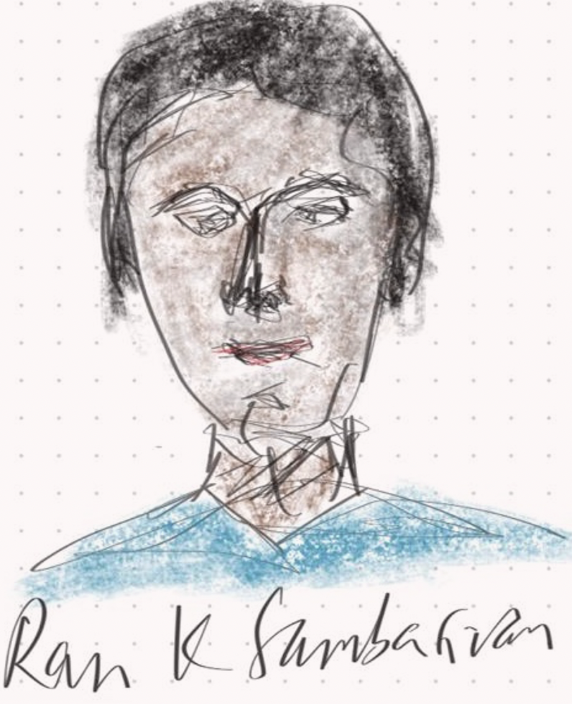

<section class="cure-intro" aria-labelledby="pdn-cure-title">
  
  <h1 id="pdn-cure-title">Pathogen data competencies and CURE modules</h1>
  
Review draft workforce competencies, explore career personas, and provide feedback on six outlines for a course-based undergraduate research experience (CURE) on wastewater pathogen surveillance.

</section>

## Table of Contents

<nav class="cure-contents" aria-labelledby="table-of-contents">
  

    
<strong>Project</strong>

    <ul>
      <li><a href="#the-goal">The Goal</a></li>
      <li><a href="#about-the-workshop">About the Workshop</a></li>
      <li><a href="#authors-affiliations-and-reuse">Authors, Affiliations, and Reuse</a></li>
    </ul>
  

  

    
<strong>Workforce competencies</strong>

    <ul>
      <li><a href="#competencies-working-group">Competencies Working Group</a></li>
      <li><a href="#draft-competencies">Draft Competencies</a></li>
      <li><a href="#feedback">Feedback Survey</a></li>
    </ul>
  

  

    
<strong>Career personas</strong>

    <ul>
      <li><a href="#career-track-personas">Career Track Personas</a></li>
      <li><a href="#healthcare-track-public-health-professional--physician">Healthcare Track</a></li>
      <li><a href="#research-track-academia-and-industry">Research Track</a></li>
    </ul>
    

      
Individual personas

      <ul>
        <li><a href="#florence-n-smith---public-health-professional">Florence N. Smith</a></li>
        <li><a href="#paul-e-johnson--infectious-disease-physicianscientist">Paul E. Johnson</a></li>
        <li><a href="#gregor-m-williams---basic-research-scientist-academic-lab">Gregor M. Williams</a></li>
        <li><a href="#rosalind-f-brown---bioinformatician-academic-genomics-core-facility">Rosalind F. Brown</a></li>
        <li><a href="#ravi-k-sambasivan---basic-research-scientist-pharmaceutical-research-campus">Ravi K. Sambasivan</a></li>
        <li><a href="#maulana-a-karim---applied-research-scientist-clinical-testing-service-provider">Maulana A. Karim</a></li>
      </ul>
    

  

  

    
<strong>CURE materials</strong>

    <ul>
      <li><a href="#cure-modules-working-group">CURE Module Working Group</a></li>
      <li><a href="#introduction-and-overview--designing-a-wastewater-surveillance-cure-module-outlines-for-undergraduate-educators">Introduction and Overview</a></li>
    </ul>
    

      
Modules and resources

      <ul>
        <li><a href="#module-1--introduction-to-pathogen-surveillance">Module 1 — Introduction to Pathogen Surveillance</a></li>
        <li><a href="#module-2--research-design-and-research-question-development">Module 2 — Research Design and Research Question Development</a></li>
        <li><a href="#module-3--water-sample-preparation-and-processing-for-sequencing">Module 3 — Water Sample Preparation and Processing for Sequencing</a></li>
        <li><a href="#module-4--bioinformatics-analyses">Module 4 — Bioinformatics Analyses</a></li>
        <li><a href="#module-5--data-analysis-and-interpretation">Module 5 — Data Analysis and Interpretation</a></li>
        <li><a href="#module-6--scientific-communication-and-data-dissemination">Module 6 — Scientific Communication and Data Dissemination</a></li>
        <li><a href="#supplementary-overarching-learning-outcomes-and-notes-on-ai-and-assessment">Supplementary learning outcomes and AI assessment</a></li>
        <li><a href="#glossary">Glossary</a></li>
        <li><a href="#laboratory-field-collection-and-publication-resources">Laboratory, Field Collection, and Publication Resources</a></li>
      </ul>
    

  

</nav>

## The Goal

Advances in genomics, bioinformatics, artificial intelligence (AI), and data science are changing how professionals study pathogens, diagnose infectious diseases, and respond to public health threats. **What knowledge, skills, and abilities should learners develop to work effectively in these fields?**

The Pathogen Data Network (PDN) is developing a community-informed framework of workforce competencies for pathogen-related careers. Educators, trainers, employers, and researchers can use it to identify learning goals, assess gaps, and align curricula. These competencies span professional practice and may require development across courses, training programs, and workplace experience.

Career personas illustrate how professionals apply these competencies in different roles. Their alignments identify areas requiring particular proficiency or emphasis. Professionals may work across trajectories, and competencies remain relevant to roles beyond those listed.

Six CURE module outlines show how educators can connect the competencies to undergraduate research using wastewater surveillance as a shared context. Each outline identifies learning outcomes, competency alignments, suggested activities, and evidence of learning.

<aside class="cure-review" aria-label="Community review">
  
<strong>Community review</strong>

  
We invite feedback on the draft competencies and CURE modules. Use the <strong>Access Google Doc</strong> buttons to read the module outlines, then submit comments and ratings through the <a href="#feedback">feedback survey</a>.

</aside>

## About the Workshop

The PDN CUREs Workshop was held March 23–25, 2026, at Cold Spring Harbor Laboratory in New York, USA. Participants developed curriculum resources and workforce competencies for careers involving infectious disease research, public health, laboratory science, and bioinformatics.

Announced internationally, the workshop attracted more than 100 applicants. Participants were selected through a competitive application process and represented universities, community colleges, research institutes, public health organizations, and industry. Their expertise included microbiology, genomics, One Health, bioinformatics, undergraduate education, workforce training, and laboratory operations.

### Rationale for Undergraduate Training

Undergraduate education provides a starting point for developing capabilities relevant to infectious disease careers. CUREs give students opportunities to develop research skills through authentic scientific investigation.

Adaptable undergraduate resources can broaden access to research experiences across institutions with different facilities, staffing, and course structures, including community colleges, regional public universities, and rural institutions.

The framework can also guide graduate and postdoctoral training, clinical and public health education, and continuing professional development.

## Feedback

The Pathogen Data Network invites undergraduate educators and colleagues in research, public health, clinical and diagnostic laboratories, industry, workforce development, and related fields to review the draft workforce competencies and CURE module outlines.

**The survey is the primary way to provide feedback.** Choose one competency or one module per submission. You can return to the survey to review additional items.

  <a class="cure-survey-link" href="https://www.surveymonkey.com/r/pdn-workforce-competencies-and-cures-review"
     target="_blank" rel="noopener">Provide feedback on the competencies and CURE modules</a>

### Review a Workforce Competency

A competency describes an observable ability to bring knowledge, skills, values, and attitudes together in practice [1]. The draft competencies describe what people need to be able to do across infectious disease career pathways. Educators and trainers can use them to decide which abilities to develop and assess in their programs.

Allow **5–10 minutes** per competency. Anyone can comment on the wording. If you work in an infectious disease–related role, start with a competency that matters to your work. First, check whether the wording clearly and unambiguously describes what someone should be able to do. Then consider which career roles require particular proficiency in the competency and which CURE learning outcomes support its development.

### Review a CURE Module

The six wastewater surveillance outlines give undergraduate educators a starting point for designing a new research course or refining an existing one. Each outline identifies core activities and learning outcomes and suggests ways to teach and assess them. A learning outcome states what students should be able to demonstrate by the end of a module. It helps instructors choose activities and decide what student work would serve as evidence of learning.

Allow **30–40 minutes** for a complete module review. Undergraduate instructors and course designers are especially well placed to judge whether the learning outcomes are appropriate for students and whether the suggested activities and assessments support them. Anyone can comment. We particularly encourage wastewater surveillance professionals to comment on how the outlines reflect the work in practice.

### Collaborate on a Publication

We welcome collaborators who want to provide extensive feedback, pilot the competencies or CURE modules in their own teaching, or both. We plan to submit a manuscript presenting the competencies and module outlines to a peer-reviewed journal. If you would like to contribute to the work and discuss potential co-authorship, use the interest form to tell us how you would like to participate.

[Register your interest in collaborating](https://www.surveymonkey.com/r/pdn-cures-collaboration)

**Reference**

1. Frank, J. R., Snell, L. S., ten Cate, O., et al. (2010). Competency-based medical education: Theory to practice. *Medical Teacher, 32*(8), 638–645. [DOI](https://doi.org/10.3109/0142159X.2010.501190).

## Competencies Working Group

The Competencies Working Group identified capabilities needed for pathogen-related careers and considered how undergraduate education could introduce them and support progression toward professional practice.

The group refined more than 100 initial ideas into the draft competency framework presented below, organized into six categories:

- Core Collaborative
- Project and Experimentation Design and Management
- Microbiology and Molecular Biology
- Analysis, Data, and AI
- Ethics, Compliance, Communication, and Trust
- Career-Spanning Learning

### Draft Competencies

This table contains the following columns:

- **Category**: The competency's grouping and scope.
- **#**: The competency's reference number.
- **Heading**: A short title for the competency.
- **Competency**: A statement of what a practitioner should be able to demonstrate. Courses contribute to its development. Full proficiency may require further education and experience.
- **CURE module alignment**: Modules whose learning outcomes contribute to the competency.
- **Career persona alignment**: Roles for which the competency warrants particular proficiency or emphasis. An omitted role may still require the competency.

<iframe class="cure-frame cure-sheet"
  src="https://docs.google.com/spreadsheets/d/e/2PACX-1vQZhqQHS7-tPcvQqtTkTi9wd3-GsQsBjUr4y-V5y2H05rNrC8_fmR0FPW8qQ4txwNBtohsoq64TbaVT/pubhtml?gid=92281840&amp;single=true&amp;widget=true&amp;headers=false"
  title="Draft Pathogen Data Network workforce competencies"
  loading="lazy">
</iframe>

  <a href="https://docs.google.com/spreadsheets/d/e/2PACX-1vQZhqQHS7-tPcvQqtTkTi9wd3-GsQsBjUr4y-V5y2H05rNrC8_fmR0FPW8qQ4txwNBtohsoq64TbaVT/pubhtml?gid=92281840&amp;single=true&amp;widget=true&amp;headers=false"
     target="_blank" rel="noopener">Open the competency table in a new tab</a>

## Career Track Personas

These personas illustrate possible combinations of education, experience, and professional responsibilities. People in similar roles may follow different training routes or work across more than one trajectory.

The career persona alignment labels identify roles that warrant a high level of proficiency or emphasis in each competency. Within this framework, **Research (Basic)** includes academic research and bioinformatics support in academic core facilities. **Research (Applied)** covers pharmaceutical research and clinical testing development, including fundamental research conducted within pharmaceutical discovery programs. The research labels reflect each persona’s primary professional context and the purpose of their program. Basic and applied research can occur across academic, public-sector, and commercial settings.

| Alignment label | Associated persona | Primary work context |
|---|---|---|
| **Healthcare (Public)** | Florence N. Smith | Public health surveillance, outbreak investigation, and interpretation of population-level evidence |
| **Healthcare (Clinical)** | Paul E. Johnson | Patient care informed by genomic evidence, alongside research co-supervision |
| **Research (Basic — Lab)** | Gregor M. Williams | Laboratory research into fundamental pathogen biology in an academic setting |
| **Research (Basic — Computational)** | Rosalind F. Brown | Bioinformatics analysis, consultation, and researcher support in an academic genomics core facility |
| **Research (Applied — Lab)** | Ravi K. Sambasivan | Fundamental laboratory research within a pharmaceutical discovery program |
| **Research (Applied — Computational)** | Maulana A. Karim | Development and evaluation of computational methods at a clinical testing service provider |

The optional **Lab** and **Computational** modifiers indicate where particular emphasis falls. Use **Lab/Computational**, or omit the modifier, when both modes of work warrant emphasis. Competencies may also be relevant to personas beyond those listed.

### Healthcare Track (Public Health Professional / Physician)

This track concerns the use of pathogen genomics in patient care and public health. It emphasizes interpreting laboratory evidence, integrating it with clinical or population data, and communicating findings to support diagnosis, treatment, surveillance, and outbreak response.

Related roles include policymakers, epidemiologists, public health data analysts, physicians, nurses, allied health professionals, clinical scientists, and laboratory scientists.

<h4 id="florence-n-smith---public-health-professional">Florence N. Smith — Public Health Professional</h4>

  

**Qualifications and background**

- BSc in nursing
- MSc in global health
- Field internship at the Ministry of Health

Florence's academic path began with an interest in community health and disease prevention. Through her nursing education, postgraduate training, and professional experience, she developed skills in epidemiology and biostatistics, alongside a growing awareness of infectious disease dynamics. Exposure to outbreak investigations and surveillance programs sparked an interest in integrating genomic data into public health decision-making. Her training increasingly combined traditional epidemiology with data analysis and interpretation of pathogen genomics.

**Current responsibilities**

- Monitoring infectious disease trends through surveillance systems
- Analyzing epidemiological data and interpreting genomic surveillance findings with laboratory and bioinformatics colleagues
- Supporting outbreak investigation and response activities
- Preparing reports and data summaries for public health stakeholders
- Collaborating with laboratories and research institutions
- Contributing to data-informed policy discussions

Florence’s work within the Ministry of Health supports the integration of pathogen genomics into routine surveillance. Her work focuses on translating complex datasets into actionable insights that inform public health responses and preparedness strategies.

<h4 id="paul-e-johnson--infectious-disease-physicianscientist">Paul E. Johnson — Infectious Disease Physician–Scientist</h4>

  

**Qualifications and background**

- MD, with initial training and practice as a general practitioner
- PhD in immunology
- Additional specialist training and practice in infectious diseases following a period in general practice
- Continuing professional development in genomics and its applications to diagnosis and treatment

Paul completed his medical and doctoral training before genomics became widely used in clinical practice. He began his career as a general practitioner and developed an interest in infectious disease through patient care and immunology research. A mid-career transition into an infectious disease specialty brought these interests together. Paul has developed a basic understanding of genomics and continues to expand his knowledge through self-directed learning and collaboration with specialists. He increasingly uses genomic information to inform clinical decisions and co-supervises research students developing new approaches, including AI and machine learning (ML) methods.

**Current responsibilities**

Paul is a senior physician–scientist who devotes approximately 80% of his time to patient care and 20% to co-supervising a research laboratory.

- Providing bedside care for patients with infectious diseases, including diagnosis, treatment, and follow-up
- Using genomic findings alongside clinical observations and other laboratory results to inform diagnosis and treatment
- Collaborating with laboratory and computational specialists to interpret genomic evidence and understand its limitations
- Co-supervising research that connects immunology and infectious disease with questions arising from clinical practice
- Contributing clinical and immunological expertise to student projects co-supervised with genomics and AI/ML specialists
- Updating his knowledge of genomics and emerging analytical methods to support patient care and research supervision

### Research Track (Academia and Industry)

Research roles span academic laboratories, genomics core facilities, pharmaceutical discovery programs, and clinical testing services. Researchers investigate fundamental biological mechanisms, develop analytical methods, and generate evidence that may support new diagnostics and therapies. The balance between discovery and application varies across projects and roles.

Related roles include laboratory researchers, bioinformaticians, pharmaceutical discovery scientists, and diagnostic method developers.

<h4 id="gregor-m-williams---basic-research-scientist-academic-lab">Gregor M. Williams — Basic Research Scientist (Academic lab)</h4>

  

**Qualifications and background**

- BSc in genetics
- PhD in microbial genetics
- Undergraduate research project in pathogen drug resistance

Gregor’s academic journey was driven by curiosity about how pathogens function and evolve. During undergraduate training, he gained experience in laboratory experimentation and theoretical concepts such as gene regulation, mutation, and host–pathogen interactions. An undergraduate research project on pathogen drug resistance led him to pursue a PhD in microbial genetics. He now investigates how genetic variation affects pathogen biology.

**Current responsibilities**

- Designing and conducting experiments on pathogen systems
- Analyzing genomic and molecular datasets
- Investigating mutations and their functional impact
- Collaborating with interdisciplinary research teams

Gregor’s work in academic and research institute settings focuses on fundamental questions in pathogen biology. His work contributes to the broader scientific understanding that underpins advances in diagnostics, therapeutics, and surveillance.

<h4 id="rosalind-f-brown---bioinformatician-academic-genomics-core-facility">Rosalind F. Brown — Bioinformatician (Academic genomics core facility)</h4>

  

**Qualifications and background**

- BSc in computational biology
- MSc in genomics
- Undergraduate experience in coding (e.g., Python/R) and data analysis

Rosalind’s background is interdisciplinary, combining an interest in biology with computational problem-solving. During her studies, she developed skills in programming, statistics, and data analysis, often applied to biological questions. Exposure to genomics datasets and sequencing technologies led her to focus on developing tools and workflows for analyzing pathogen data.

**Current responsibilities**

- Consulting with research groups on study design, data quality, and appropriate analysis methods
- Developing and running bioinformatics pipelines
- Performing genome assembly, annotation, and quality control
- Managing datasets using Findable, Accessible, Interoperable, and Reusable (FAIR) principles
- Creating reproducible workflows and documentation
- Collaborating with laboratory and public health teams
- Supporting tool development and data integration
- Explaining analysis results and limitations and helping researchers use documented workflows

Rosalind supports research groups investigating fundamental questions in pathogen biology through a shared academic genomics core facility. She helps teams plan analyses, interpret findings, and produce reproducible data and methods.

<h4 id="ravi-k-sambasivan---basic-research-scientist-pharmaceutical-research-campus">Ravi K. Sambasivan — Basic Research Scientist (Pharmaceutical research campus)</h4>

  

**Qualifications and background**

- BSc in physical, biological, or chemical sciences with exposure to data analysis
- PhD in microbial genetics
- Undergraduate research project in pathogen drug resistance

**Current responsibilities**

- Designing and conducting experiments to study fundamental biological mechanisms
- Analyzing experimental and genomic data to test hypotheses and guide follow-up studies
- Collaborating with microbiologists, geneticists, and computational scientists to interpret findings and develop new research questions
- Developing research proposals and contributing to project reviews that guide internal funding, external collaborations, and grant applications where relevant
- Preparing manuscripts for peer-reviewed journals and presenting findings at scientific meetings
- Mentoring research staff, interns, and collaborating students in experimental design, data interpretation, and scientific writing

Ravi studies fundamental mechanisms of pathogen growth, survival, and host interactions within a pharmaceutical discovery program. His alignment with Research (Applied — Lab) reflects the program’s therapeutic objectives. His investigations build biological understanding that may inform future therapies.

<h4 id="maulana-a-karim---applied-research-scientist-clinical-testing-service-provider">Maulana A. Karim — Applied Research Scientist (Clinical testing service provider)</h4>

  

**Qualifications and background**

- BSc in data analysis and genomics
- PhD in data science and genomics
- Undergraduate research project in data analysis

**Current responsibilities**

- Developing bioinformatics workflows for pathogen sequence data generated in-house and obtained from public repositories
- Standardizing sample records so datasets from different laboratories can be combined and compared
- Evaluating analysis methods against reference samples and datasets, documenting their accuracy, reproducibility, and limitations for the intended clinical testing application
- Investigating discrepancies between computational results and laboratory findings with colleagues at the bench
- Documenting workflows and reporting their performance to teams developing surveillance and diagnostic tools
- Collaborating with laboratory quality and software teams to introduce and maintain analysis workflows for clinical testing

Maulana works in the research and development team of a clinical testing service provider. He collaborates with laboratory scientists to develop and evaluate computational methods for detecting and characterizing infectious agents and supports their introduction into routine testing.

<h2 id="cure-modules-working-group">CURE Module Working Group</h2>

The CURE Module Working Group developed six curriculum outlines aligned with the Pathogen Data Network’s workforce competencies. Using wastewater surveillance as a shared research context, the modules guide instructors from introducing surveillance and designing an investigation through water sampling and preparation, bioinformatics, data interpretation, and scientific communication. Each module connects core and supplementary learning outcomes to relevant competencies and suggests activities and ways for students to demonstrate their learning. Instructors can use the outlines to design or refine a course-based undergraduate research experience that fits their students, research questions, and available resources. The accompanying glossary defines technical terms, and the resource list links to field and laboratory protocols and publication resources.

### Introduction and Overview — Designing a Wastewater Surveillance CURE: Module Outlines for Undergraduate Educators

  <a class="cure-doc-link"
     href="https://docs.google.com/document/d/1MMof5lqChEHEbDdkbmO31msKr52BJMLQ-8NjGG-CJ4I/edit?usp=sharing"
     target="_blank" rel="noopener"
     aria-label="Access Google Doc for the Introduction and Overview (opens in a new tab)">Access Google Doc</a>

  
Preview the introduction and overview

  <iframe class="cure-frame"
    src="https://docs.google.com/document/d/e/2PACX-1vS6htENXEJtPr4gxmTF9iV3qnJUyKaurQ_U6AnYMMT-qZvyaqap9kiTchTEN0HEWtuFd-A4gN45nAox/pub?embedded=true"
    title="Designing a Wastewater Surveillance CURE: Module Outlines for Undergraduate Educators"
    loading="lazy">
  </iframe>

### Module 1 — Introduction to Pathogen Surveillance

  <a class="cure-doc-link"
     href="https://docs.google.com/document/d/1g6jW5FnAyXs6eP8OVQAsL-UrikNHBgN7zDB-Ews8FTw/edit?usp=sharing"
     target="_blank" rel="noopener"
     aria-label="Access Google Doc for Module 1 (opens in a new tab)">Access Google Doc</a>

  
Preview Module 1

  <iframe class="cure-frame"
    src="https://docs.google.com/document/d/e/2PACX-1vT9OUnH6Ia7H5D7_lEDDxUWv25KSasc96dMyQrGgtZV3gkjqHwDjapa4bmC1SxFtFQsNNUMp5uuf11U/pub?embedded=true"
    title="Module 1 — Introduction to Pathogen Surveillance"
    loading="lazy">
  </iframe>

### Module 2 — Research Design and Research Question Development

  <a class="cure-doc-link"
     href="https://docs.google.com/document/d/13lVEzb5706ETYlOEbqdEglLUClTCKG6cZ8pZ33bVtu4/edit?usp=sharing"
     target="_blank" rel="noopener"
     aria-label="Access Google Doc for Module 2 (opens in a new tab)">Access Google Doc</a>

  
Preview Module 2

  <iframe class="cure-frame"
    src="https://docs.google.com/document/d/e/2PACX-1vQmmnl-1Y781JbgyQqxbGbPcfujhGEaBV3uccKuIkXOjsIHO9YebbKD8w-hzbn056TfhRaO_G0TXKkj/pub?embedded=true"
    title="Module 2 — Research Design and Research Question Development"
    loading="lazy">
  </iframe>

### Module 3 — Water Sample Preparation and Processing for Sequencing

  <a class="cure-doc-link"
     href="https://docs.google.com/document/d/1O1oV1dMXnZUrTXCaS51qVh7RmQYliLSN-qH1gMN6DWc/edit?usp=sharing"
     target="_blank" rel="noopener"
     aria-label="Access Google Doc for Module 3 (opens in a new tab)">Access Google Doc</a>

  
Preview Module 3

  <iframe class="cure-frame"
    src="https://docs.google.com/document/d/e/2PACX-1vT5C0Lqm1N_sFkaJBQBbjSbzMjqvvhDk3RPcB_Kh5TzXZpKnGlvPaU7DuM6N-wIjHz9ug79rAYkLnhr/pub?embedded=true"
    title="Module 3 — Water Sample Preparation and Processing for Sequencing"
    loading="lazy">
  </iframe>

### Module 4 — Bioinformatics Analyses

  <a class="cure-doc-link"
     href="https://docs.google.com/document/d/1EOzWrjlHuGosFmoB6QrI69NfGacaUNdoChUYIHocfoY/edit?usp=sharing"
     target="_blank" rel="noopener"
     aria-label="Access Google Doc for Module 4 (opens in a new tab)">Access Google Doc</a>

  
Preview Module 4

  <iframe class="cure-frame"
    src="https://docs.google.com/document/d/e/2PACX-1vSXP2dyfoSzhZSRuaH_9ztWHWbJYy0J8NKQp94483j2SpAXsl2dilGDqFbMmG0e2AcVkWUPBrfvgExE/pub?embedded=true"
    title="Module 4 — Bioinformatics Analyses"
    loading="lazy">
  </iframe>

### Module 5 — Data Analysis and Interpretation

  <a class="cure-doc-link"
     href="https://docs.google.com/document/d/1hha2HqbMoPeUpVwBeJ8bESatjQwPw4Xtgj0Bsm2T1Do/edit?usp=sharing"
     target="_blank" rel="noopener"
     aria-label="Access Google Doc for Module 5 (opens in a new tab)">Access Google Doc</a>

  
Preview Module 5

  <iframe class="cure-frame"
    src="https://docs.google.com/document/d/e/2PACX-1vSjlasneSRQkpoLl5oOolSxdE8pt-niKL-HndqysKnd0o5UQsGbv34C2WJs6yR6NY7Qn8s8U3ZpXdti/pub?embedded=true"
    title="Module 5 — Data Analysis and Interpretation"
    loading="lazy">
  </iframe>

### Module 6 — Scientific Communication and Data Dissemination

  <a class="cure-doc-link"
     href="https://docs.google.com/document/d/12tBYAZdlooCFcPJ1TI6WQbQNfAS9emuHNcrdCLHK2es/edit?usp=sharing"
     target="_blank" rel="noopener"
     aria-label="Access Google Doc for Module 6 (opens in a new tab)">Access Google Doc</a>

  
Preview Module 6

  <iframe class="cure-frame"
    src="https://docs.google.com/document/d/e/2PACX-1vTcbDaw_7cn4mj5xEslGZ_WRAuvx8MkYU0BkM461Ww0wBkIlJjVfrC91SNUCUtDqYt2cFVpNb65Nq7z/pub?embedded=true"
    title="Module 6 — Scientific Communication and Data Dissemination"
    loading="lazy">
  </iframe>

### Supplementary Overarching Learning Outcomes and Notes on AI and Assessment

  <a class="cure-doc-link"
     href="https://docs.google.com/document/d/11rUlfoq1pHBN_UpWAEA6XYOYsO9GTbInHoIxy_WoWTE/edit?usp=sharing"
     target="_blank" rel="noopener"
     aria-label="Access Google Doc for Supplementary Learning Outcomes and AI Assessment (opens in a new tab)">Access Google Doc</a>

  
Preview the supplementary materials

  <iframe class="cure-frame"
    src="https://docs.google.com/document/d/e/2PACX-1vQn-CQUNve_fcj5-Q3fKtmalmuvrigDOLfK-UeB2MW5Ok95SMGHdRxExgeDvGiLNERXCVJXYdBTH9HT/pub?embedded=true"
    title="Supplementary Overarching Learning Outcomes and Notes on AI and Assessment"
    loading="lazy">
  </iframe>

### Glossary

  <a class="cure-doc-link"
     href="https://docs.google.com/document/d/1elxXqMHlRZOQ9NCpGQsgL_phDfL13QXG7XB3Qv6ELdQ/edit?usp=sharing"
     target="_blank" rel="noopener"
     aria-label="Access Google Doc for the Glossary (opens in a new tab)">Access Google Doc</a>

  
Preview the glossary

  <iframe class="cure-frame"
    src="https://docs.google.com/document/d/e/2PACX-1vTyjsvD5Vz1lLwnr2btOQxD5mqzkXCQDtVTLdQCVMUAN-lOn7g97pL6KWCjflNa6UUEFUhTK02dIMFT/pub?embedded=true"
    title="Glossary"
    loading="lazy">
  </iframe>

### Laboratory, Field Collection, and Publication Resources

  <a class="cure-doc-link"
     href="https://docs.google.com/document/d/1Y_Lj1AGql_lJbE5xBCxZuck0suhY3YIgLTFP8FIkgco/edit?usp=sharing"
     target="_blank" rel="noopener"
     aria-label="Access Google Doc for Laboratory, Field Collection, and Publication Resources (opens in a new tab)">Access Google Doc</a>

  
Preview the resources

  <iframe class="cure-frame"
    src="https://docs.google.com/document/d/e/2PACX-1vQI8Y22k8jtjbd6TQpWkfCG68k9yeg72bKE-VDb0ojUi6702wMAGpi96jr6R5EGCRgHAApS7YOCOIKu/pub?embedded=true"
    title="Laboratory, Field Collection, and Publication Resources"
    loading="lazy">
  </iframe>

### Authors, Affiliations, and Reuse

These draft materials are publicly available for review. A reuse license has not yet been assigned. For questions or collaboration, contact [Jason Williams](mailto:williams@cshl.edu).

- Anna Maria Niewiadomska, Oxford Nanopore Technologies
- Athina Gavriilidou, University of Lausanne
- Martha Carolina Mehaffy, Colorado State University
- Carlos Goller, North Carolina State University
- Joseph Larkin, University of Florida
- Jamal Sheriff, University of Illinois Chicago and Bacterial and Viral Bioinformatics Resource Center
- Liã Bárbara Arruda, Wellcome Sanger Institute
- Lakshmanan Iyer, LabCorp
- Michaela Gazdik Stofer, North Carolina State University
- Julien Alban Nguinkal, Bernhard Nocht Institute for Tropical Medicine
- Zach Popkin-Hall, Western Connecticut State University
- Sarah Buddenborg, McGill University
- Valerie Carson, Hillsborough College
- Anna Feitzinger, Cold Spring Harbor Laboratory and Pathogen Data Network
- Jason Williams, Cold Spring Harbor Laboratory and Pathogen Data Network

**Funding Acknowledgment**

This project is supported by the National Institute of Allergy and Infectious Diseases of the National Institutes of Health under Award Number U24AI183840. The content is solely the responsibility of the authors and does not necessarily represent the official views of the National Institutes of Health.
