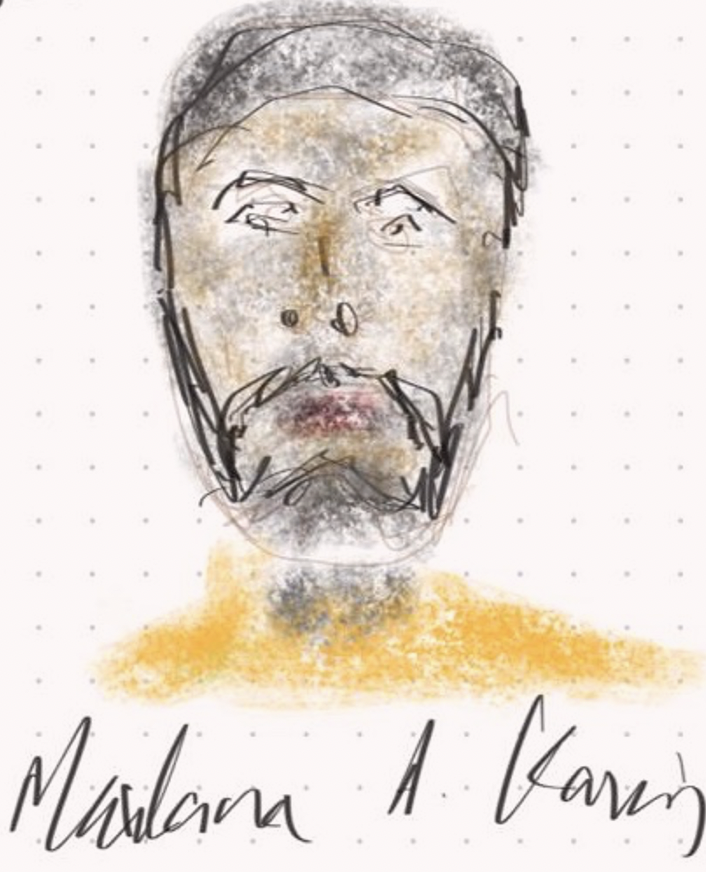

<section class="cure-intro" aria-labelledby="pdn-cure-title">
  
  <h1 id="pdn-cure-title">Pathogen data competencies and CURE modules</h1>
  
Review draft workforce competencies, explore career personas, and provide feedback on six outlines for a course-based undergraduate research experience (CURE) on wastewater pathogen surveillance.

</section>

## Table of Contents

<nav class="cure-contents" aria-labelledby="table-of-contents">
  

    
<strong>Project</strong>

    <ul>
      <li><a href="#the-goal">The goal</a></li>
      <li><a href="#about-the-workshop">About the workshop</a></li>
      <li><a href="#authors-affiliations-and-reuse">Authors, Affiliations, and Reuse</a></li>
    </ul>
  

  

    
<strong>Workforce competencies</strong>

    <ul>
      <li><a href="#competencies-working-group">Competencies Working Group</a></li>
      <li><a href="#draft-competencies">Draft Competencies</a></li>
      <li><a href="#feedback">Feedback Survey</a></li>
    </ul>
  

  

    
<strong>Career personas</strong>

    <ul>
      <li><a href="#career-track-personas">Career Track Personas</a></li>
      <li><a href="#healthcare-track-public-health-professional--clinical-scientist">Healthcare Track</a></li>
      <li><a href="#research-track-basic-research-scientist--applied-research-scientist">Research Track</a></li>
      <li><a href="#industry-track-pathogen-data-scientist">Industry Track</a></li>
    </ul>
    

      
Individual personas

      <ul>
        <li><a href="#florence-n-smith---public-health-professional">Florence N. Smith</a></li>
        <li><a href="#paul-e-johnson---clinical-scientist">Paul E. Johnson</a></li>
        <li><a href="#gregor-m-williams---basic-research-scientist">Gregor M. Williams</a></li>
        <li><a href="#rosalind-f-brown---applied-research-scientist">Rosalind F. Brown</a></li>
        <li><a href="#ravi--k-sambasivan---basic-research-scientist">Ravi K. Sambasivan</a></li>
        <li><a href="#maulana-a-karim---applied-research-scientist">Maulana A. Karim</a></li>
      </ul>
    

  

  

    
<strong>CURE materials</strong>

    <ul>
      <li><a href="#cure-modules-working-group">CURE Module Working Group</a></li>
      <li><a href="#introduction-and-overview--designing-a-wastewater-surveillance-cure-module-outlines-for-undergraduate-educators">Introduction and Overview</a></li>
    </ul>
    

      
Modules and resources

      <ul>
        <li><a href="#module-1--introduction-to-pathogen-surveillance">Module 1 — Introduction to Pathogen Surveillance</a></li>
        <li><a href="#module-2--research-design-and-research-question-development">Module 2 — Research Design and Research Question Development</a></li>
        <li><a href="#module-3--water-sample-preparation-and-processing-for-sequencing">Module 3 — Water Sample Preparation and Processing for Sequencing</a></li>
        <li><a href="#module-4--bioinformatics-analyses">Module 4 — Bioinformatics Analyses</a></li>
        <li><a href="#module-5--data-analysis-and-interpretation">Module 5 — Data Analysis and Interpretation</a></li>
        <li><a href="#module-6--scientific-communication-and-data-dissemination">Module 6 — Scientific Communication and Data Dissemination</a></li>
        <li><a href="#supplementary-overarching-learning-outcomes-and-notes-on-ai-and-assessment">Supplementary learning outcomes and AI assessment</a></li>
        <li><a href="#glossary">Glossary</a></li>
        <li><a href="#laboratory-field-collection-and-publication-resources">Laboratory, Field Collection, and Publication Resources</a></li>
      </ul>
    

  

</nav>

## The goal

Advances in genomics, bioinformatics, artificial intelligence, and data-intensive approaches are transforming how we study pathogens, monitor infectious diseases, develop diagnostics, support clinical decision-making, and respond to public health challenges. At the same time, the infectious disease workforce is highly diverse, spanning clinical care, public health, surveillance, biotechnology, pharmaceutical development, laboratory science, data science, and research. As technologies evolve, educators face an important question: **What knowledge, skills, and abilities should learners develop to prepare them for success in these rapidly changing fields?**

The goal of this project is to develop a community-informed framework of workforce competencies that describes the capabilities needed for competent practice in pathogen-related careers. These competencies are not intended to represent the requirements of a single course or degree program. Rather, they provide a shared language that educators, trainers, employers, researchers, and workforce development organizations can use to discuss learning goals, identify gaps, align curricula, and guide the design of educational experiences.

Because the infectious disease workforce encompasses many different career pathways, we have also developed a set of **personas** that represent broad categories of professionals. These personas help identify where a competency may be most relevant without implying that every competency is equally important for every role. The personas are intended to support curriculum planning, workforce alignment, and discussion among stakeholders while recognizing that many professionals work across traditional boundaries and may require competencies associated with multiple personas.

In parallel with the competency framework, this project presents a series of modular **Course-based Undergraduate Research Experience (CURE)** curriculum outlines. These modules are designed to provide flexible pathways for integrating pathogen data, genomics, bioinformatics, artificial intelligence, ethics, and workforce preparation into undergraduate education. Each module identifies the competencies it supports and provides guidance for how educators can incorporate authentic research experiences into their courses. The draft modules provide practical examples of how the competency framework can be translated into educational practice.

<aside class="cure-review" aria-label="Community review">
  
<strong>Community review</strong>

  
We invite educators, researchers, clinicians, public health professionals, industry partners, workforce development leaders, and other stakeholders to review these drafts. The survey collects feedback on the competencies and their alignment with career roles. The <strong>Access Google Doc</strong> buttons open the module outlines and comments and ratings can be entered in the Feedback survey.

  
<a href="#feedback">Feedback Survey</a>

</aside>

## About the workshop

The PDN CUREs Workshop was held March 23–25, 2026, at Cold Spring Harbor Laboratory in New York, USA, to support the development of curriculum resources and competencies for the education and training of the infectious-disease workforce. The workshop was developed in response to growing demand for educational materials that prepare students for careers involving infectious disease research, public health, laboratory science, bioinformatics, and related fields.
The workshop was announced internationally and attracted more than 100 applicants. A competitive cohort of educators, researchers, bioinformaticians, public health specialists, and industry representatives was selected to participate. Attendees represented a broad range of expertise, including microbiology, genomics, One Health, bioinformatics, undergraduate education, workforce training, and laboratory operations.

The workshop brought together participants from universities, community colleges, research institutes, public health-oriented organizations, industry, and international training programs. These broad perspectives were essential for ensuring that resulting materials would be relevant across multiple career paths and educational settings, including undergraduate education, workforce training, clinical and public health contexts, and laboratory research.

### Rationale for undergraduate training

Although NIH's emphasis on trainee preparation generally targets the graduate level, choosing undergraduate education as the baseline provides several advantages. Focusing on introductory experiences allowed participants to develop materials that support many future career pathways, including clinical care, diagnostics, public health, surveillance, biotechnology, pharmaceutical and applied research, and basic research. Course-based Undergraduate Research Experiences (CUREs) provide an evidence-based and highly effective model for building the foundational skills, competencies, and habits of mind needed for infectious disease careers.

Undergraduate-focused resources can also engage students outside elite research institutions, including at community colleges, regional public universities, rural institutions, and other settings that may have fewer resources. This is especially important because future workforce needs will require talent from a much wider range of educational backgrounds and geographic regions.
The resulting competency framework serves as a foundation for learners at later career stages. Graduate students, postdoctoral fellows, clinical laboratory personnel, public health professionals, and other advanced learners can also benefit from the competency framework and modular training resources developed through this effort.

## Feedback

The Pathogen Data Network invites undergraduate educators and colleagues in research, public health, clinical and diagnostic laboratories, industry, workforce development, and related fields to review the draft workforce competencies and course-based undergraduate research experience (CURE) module outlines.

**The survey is the primary way to provide feedback.** Choose one competency or one module per submission. You can return to the survey to review additional items.

  <a class="cure-survey-link" href="https://www.surveymonkey.com/r/pdn-workforce-competencies-and-cures-review"
     target="_blank" rel="noopener">Provide feedback on the Competencies and/or CURE modules</a>

### Review a workforce competency

A competency describes an observable ability to bring knowledge, skills, values, and attitudes together in practice [1]. The draft competencies describe what people need to be able to do across infectious disease career pathways. Educators and trainers can use them to decide which abilities to develop and assess in their programs.

Allow **5–10 minutes** per competency. Anyone can comment on the wording. If you work in an infectious disease–related role, start with a competency that matters to your work. First, check whether the wording clearly and unambiguously describes what someone should be able to do. Then consider which career pathways the competency is relevant to and where students could develop it in the CURE modules.

### Review a CURE module

The six wastewater surveillance outlines give undergraduate educators a starting point for designing a new research course or refining an existing one. Each outline identifies core activities, sets learning outcomes, and suggests ways to teach and assess them. A learning outcome states what students should be able to demonstrate by the end of a module. It helps instructors choose activities and decide what student work would serve as evidence of learning.

Allow **30–40 minutes** for a complete module review. Undergraduate instructors and course designers are especially well placed to judge whether the learning outcomes are appropriate for students and whether the suggested activities and assessments support them. Anyone can comment. We particularly encourage wastewater surveillance professionals to comment on how the outlines reflect the work in practice.

### Collaborate on a publication

We welcome collaborators who want to provide extensive feedback, pilot the competencies or CURE modules in their own teaching, or both. We plan to submit a manuscript presenting the competencies and module outlines to a peer-reviewed journal. If you would like to contribute to the work and discuss potential co-authorship, use the interest form to tell us how you would like to participate.

[Register your interest in collaborating](https://www.surveymonkey.com/r/pdn-cures-collaboration)

**Reference**

1. Frank, J. R., Snell, L. S., ten Cate, O., et al. (2010). Competency-based medical education: Theory to practice. *Medical Teacher, 32*(8), 638–645. [DOI](https://doi.org/10.3109/0142159X.2010.501190).

## Competencies Working Group

The Competencies Working Group focused on defining the broad competencies needed for future success in pathogen-related fields. Participants emphasized that competencies should be appropriate for undergraduate learners while remaining relevant to workforce needs.

The group initially assembled more than 100 competency ideas spanning laboratory skills, project management, bioinformatics, ethics, data analysis, and professional skills. Participants agreed that these should eventually be refined into a smaller, more manageable set of approximately 30 high-level competencies.

Key competency domains identified by the group included:

- Core project and teamwork skills
- Experimental design and project management
- Pathogen biology and microbiology
- Laboratory and sequencing methods
- Bioinformatics and data analysis
- Statistics and interpretation
- Artificial intelligence, automation, and responsible use of AI tools
- Ethics, privacy, and trust
- Communication and science communication
- Career-spanning learning and workforce readiness

### Draft Competencies

This chart has the following features:

- **Category**: This is the major grouping for a set of competencies and the defining characteristics shared by competencies within that group. For example, *Core Collaborative* includes the core (sometimes called "soft") skills needed for effective collaboration and teamwork.
- **#**: Our numbering of the competency.
- **Heading**: A short title that captures the essence of the competency.
- **Competency**: A set of knowledge, skills, and abilities that represent what a competent practitioner should be able to do. While no single course, undergraduate or otherwise, may be sufficient to achieve competency, the overall curriculum or course of training should aim to enable a learner to achieve the stated competency.
- **CURE matching alignment**: These are the designations of modular curriculum outlines that this group is developing and that address the indicated competency.
- **CURE persona alignment**: These are the personas for which the listed competency will typically be most relevant.

<iframe class="cure-frame cure-sheet"
  src="https://docs.google.com/spreadsheets/d/e/2PACX-1vQZhqQHS7-tPcvQqtTkTi9wd3-GsQsBjUr4y-V5y2H05rNrC8_fmR0FPW8qQ4txwNBtohsoq64TbaVT/pubhtml?gid=92281840&amp;single=true&amp;widget=true&amp;headers=false"
  title="Draft Pathogen Data Network workforce competencies"
  loading="lazy">
</iframe>

  <a href="https://docs.google.com/spreadsheets/d/e/2PACX-1vQZhqQHS7-tPcvQqtTkTi9wd3-GsQsBjUr4y-V5y2H05rNrC8_fmR0FPW8qQ4txwNBtohsoq64TbaVT/pubhtml?gid=92281840&amp;single=true&amp;widget=true&amp;headers=false"
     target="_blank" rel="noopener">Open the competency table in a new tab</a>

## Career track personas

The group also discussed the importance of developing personas that reflect common career pathways, such as laboratory technicians, bioinformatics analysts, public health staff, clinical laboratory personnel, undergraduate researchers, and biotechnology employees. These personas will help ensure that competencies are relevant to real-world workforce roles.

### Healthcare Track (Public Health Professional / Clinical Scientist)

This track is designed for students interested in applying pathogen genomics in healthcare and public health settings. It brings together perspectives from public health and clinical science, focusing on how genomic data can inform disease surveillance, diagnostics, and patient care. It focuses on exploring how pathogen data moves from laboratory generation to real-world decision-making, developing skills to interpret and communicate findings in ways that support outbreak response, healthcare systems, and community health outcomes.

Examples of professionals related to this track: policy-makers, epidemiologists, data modeling analysts, physicians, nurses, allied health professionals, clinical scientists, laboratory scientists, among others.

#### Florence N. Smith - Public Health Professional

  

**Qualification and background**

- BSc in Nursing
- MSc in Global Health
- Field internship at the Ministry of Health

Florence's academic path began with an interest in community health and disease prevention. During her undergraduate studies, she developed skills in epidemiology and biostatistics, alongside a growing awareness of infectious disease dynamics. Exposure to outbreak investigations and surveillance programs sparked an interest in integrating genomic data into public health decision-making. Her training increasingly combined traditional epidemiology with data analysis and interpretation of pathogen genomics.

**Activities of current role**

- Monitoring infectious disease trends through surveillance systems
- Analysing epidemiological and genomic datasets
- Supporting outbreak investigation and response activities
- Preparing reports and data summaries for public health stakeholders
- Collaborating with laboratories and research institutions
- Contributing to data-informed policy discussions

Florence’s work within the Ministry of Health supports the integration of pathogen genomics into routine surveillance. Her work focuses on translating complex datasets into actionable insights that inform public health responses and preparedness strategies.

#### Paul E. Johnson - Clinical Scientist

  

**Qualification and background**

-	BSc in Biomedical Science
-	Clinical training programme in laboratory medicine
-	Hospital diagnostic laboratory placement

Paul’s training began with a strong foundation in laboratory sciences and human health. During his studies, he developed practical skills in microbiology, molecular biology, and diagnostic techniques. Exposure to clinical settings introduced him to pathogen detection and patient-centered applications of laboratory work. Increasingly, he gained experience with sequencing technologies and genomic data interpretation as part of cutting-edge diagnostics methods.

**Activities of current role**

-	Processing clinical samples for pathogen detection and sequencing
-	Performing and validating molecular diagnostic assays
-	Interpreting genomic data in a clinical context
-	Ensuring laboratory quality control and compliance
-	Communicating results to clinicians and healthcare teams
-	Supporting infection control and surveillance efforts

Paul’s work in hospital laboratories contributes to the accurate and timely diagnosis of infectious diseases. His role connects laboratory data with patient care, with growing involvement in integrating genomics into routine diagnostics.

### Research Track (Basic Research Scientist / Applied Research Scientist)

This track is aimed at students interested in advancing pathogen genomics through research and innovation. It combines foundational biological inquiry with practical, data-driven approaches, spanning both basic and applied science. It focuses on engaging with questions about pathogen biology, evolution, and function, while also developing computational and analytical skills to work with genomic data. The track encourages students to explore how research discoveries can be translated into tools, methods, and knowledge that strengthen our understanding and management of infectious diseases.

#### Gregor M. Williams - Basic Research Scientist

  

**Qualification and background**

-	BSc in Genetics
-	PhD in Microbial Genetics
-	Undergraduate research project in pathogen drug resistance

Gregor’s academic journey was driven by curiosity about how pathogens function and evolve. During undergraduate training, he gained experience in laboratory experimentation and theoretical concepts such as gene regulation, mutation, and host–pathogen interactions. Research projects deepen his interest in understanding mechanisms at the molecular level, often leading to further research training.

**Activities of current role**

-	Designing and conducting experiments on pathogen systems
-	Analysing genomic and molecular datasets
-	Performing genome annotation and comparative analyses
-	Investigating mutations and their functional impact
-	Collaborating with interdisciplinary research teams

Gregor’s work in academic and research institute settings focuses on fundamental questions in pathogen biology. His work contributes to the broader scientific understanding that underpins advances in diagnostics, therapeutics, and surveillance.

#### Rosalind F. Brown - Applied Research Scientist

  

**Qualification and background**

-	BSc in Computational Biology
-	MSc in Genomics
-	Undergraduate experience in coding (e.g., Python/R) and data analysis

Rosalind’s background is interdisciplinary, combining an interest in biology with computational problem-solving. During her studies, she developed skills in programming, statistics, and data analysis, often applied to biological questions. Exposure to genomics datasets and sequencing technologies led her to focus on developing tools and workflows for analyzing pathogen data.

**Activities of current role**

-	Developing and running bioinformatics pipelines
-	Performing genome assembly, annotation, and quality control
-	Managing datasets using FAIR principles
-	Creating reproducible workflows and documentation
-	Collaborating with laboratory and public health teams
-	Supporting tool development and data integration

Rosalind works at the interface of biology and data science, translating complex genomic data into usable outputs. Her role is central to making pathogen genomics scalable, reproducible, and accessible across different research and public health contexts.

### Industry Track (Pathogen Data Scientist)

This track is designed for students interested in applying pathogen genomics in industry settings. It brings together perspectives from public health and clinical science, focusing on how genomics and real world data can inform disease surveillance, diagnostics, and patient care. It focuses on exploring how pathogen data in industrial settings leads to real-world decision-making, developing skills to interpret and communicate findings in ways that support diagnostic test development, outbreak response, healthcare systems, and community health outcomes.

Examples of professionals related to this track: Genomics and pathogen data scientists with varied backgrounds actively involved in analyzing real world data for pathogen surveillance, develop diagnostic tools to detect novel pathogens and outbreaks.

#### Ravi  K. Sambasivan - Basic Research Scientist

  

**Qualification and background**

-	BSc in physical, biological or chemical sciences with exposure to data analysis
-	PhD in quantitative science, genomics, microbiome or data sciences
-	Undergraduate research project in pathogen drug resistance

**Activities of current role**

- Designing and conducting experiments to study fundamental biological mechanisms
- Analyzing experimental and genomic data to test hypotheses and guide follow-up studies
- Collaborating with microbiologists, geneticists, and computational scientists to interpret findings and develop new research questions
- Writing grant proposals to support new and ongoing research
- Preparing manuscripts for peer-reviewed journals and presenting findings at scientific meetings
- Mentoring students who join the research team in experimental design, data interpretation, and scientific writing

Ravi was inspired by the bugs around him and the role that they play in human health and diseases. His academic journey was in basic sciences with exposure to the role of viruses, bacteria and other pathogens with their role in human life. His experience in the undergrad research project on data analysis and subsequent PhD in genomics prepared to delve into the basic science of pathogens and their role in disease outbreak detection, surveillance and how it can lead to diagnostic and clinical interventions.

#### Maulana A. Karim - Applied Research Scientist

  

**Qualification and background**

-	BSc in data analysis and genomics
-	PhD in data sciences and genomics
-	Undergraduate research project in data analysis

**Activities of current role**
- Developing bioinformatics workflows for pathogen sequence data generated in-house and obtained from public repositories
- Standardizing sample records so datasets from different laboratories can be combined and compared
- Testing analysis methods on reference datasets to compare accuracy, consistency, and processing time
- Investigating discrepancies between computational results and laboratory findings with colleagues at the bench
- Documenting workflows and reporting their performance to teams developing surveillance and diagnostic tools

Maulana witnessed how COVID19 was tackled world-wide with the public and private healthcare sector come together to develop rapid diagnostic tests and surveillance of SARS-CoV-2 virus, the causative agent of the pandemic.  His basic training in data sciences and genomics with inroads to bacterial and viral sequence and data analysis led him to a role in industry. In industry he works with a team of wet and dry lab scientists to help develop novel methods of analyzing the huge of amount of pathogen data produced in-house and in public repositories.

## CURE modules Working Group

The CURE Module Working Group developed six curriculum outlines aligned with the Pathogen Data Network’s workforce competencies. Using wastewater surveillance as a shared research context, the modules guide instructors from introducing surveillance and designing an investigation through water sampling and preparation, bioinformatics, data interpretation, and scientific communication. Each module connects core and supplementary learning outcomes to relevant competencies and suggests activities and ways for students to demonstrate their learning. Instructors can use the outlines to design or refine a course-based undergraduate research experience that fits their students, research questions, and available resources. An accompanying glossary and resources provide stepping stones for instructors to adapt the content as they design or modify their CURE.

### Introduction and Overview — Designing a Wastewater Surveillance CURE: Module Outlines for Undergraduate Educators

  <a class="cure-doc-link"
     href="https://docs.google.com/document/d/1MMof5lqChEHEbDdkbmO31msKr52BJMLQ-8NjGG-CJ4I/edit?usp=sharing"
     target="_blank" rel="noopener"
     aria-label="Access Google Doc for the Introduction and Overview (opens in a new tab)">Access Google Doc</a>

  
Preview the introduction and overview

  <iframe class="cure-frame"
    src="https://docs.google.com/document/d/e/2PACX-1vS6htENXEJtPr4gxmTF9iV3qnJUyKaurQ_U6AnYMMT-qZvyaqap9kiTchTEN0HEWtuFd-A4gN45nAox/pub?embedded=true"
    title="Designing a Wastewater Surveillance CURE: Module Outlines for Undergraduate Educators"
    loading="lazy">
  </iframe>

### Module 1 — Introduction to Pathogen Surveillance

  <a class="cure-doc-link"
     href="https://docs.google.com/document/d/1g6jW5FnAyXs6eP8OVQAsL-UrikNHBgN7zDB-Ews8FTw/edit?usp=sharing"
     target="_blank" rel="noopener"
     aria-label="Access Google Doc for Module 1 (opens in a new tab)">Access Google Doc</a>

  
Preview Module 1

  <iframe class="cure-frame"
    src="https://docs.google.com/document/d/e/2PACX-1vT9OUnH6Ia7H5D7_lEDDxUWv25KSasc96dMyQrGgtZV3gkjqHwDjapa4bmC1SxFtFQsNNUMp5uuf11U/pub?embedded=true"
    title="Module 1 — Introduction to Pathogen Surveillance"
    loading="lazy">
  </iframe>

### Module 2 — Research Design and Research Question Development

  <a class="cure-doc-link"
     href="https://docs.google.com/document/d/13lVEzb5706ETYlOEbqdEglLUClTCKG6cZ8pZ33bVtu4/edit?usp=sharing"
     target="_blank" rel="noopener"
     aria-label="Access Google Doc for Module 2 (opens in a new tab)">Access Google Doc</a>

  
Preview Module 2

  <iframe class="cure-frame"
    src="https://docs.google.com/document/d/e/2PACX-1vQmmnl-1Y781JbgyQqxbGbPcfujhGEaBV3uccKuIkXOjsIHO9YebbKD8w-hzbn056TfhRaO_G0TXKkj/pub?embedded=true"
    title="Module 2 — Research Design and Research Question Development"
    loading="lazy">
  </iframe>

### Module 3 — Water Sample Preparation and Processing for Sequencing

  <a class="cure-doc-link"
     href="https://docs.google.com/document/d/1O1oV1dMXnZUrTXCaS51qVh7RmQYliLSN-qH1gMN6DWc/edit?usp=sharing"
     target="_blank" rel="noopener"
     aria-label="Access Google Doc for Module 3 (opens in a new tab)">Access Google Doc</a>

  
Preview Module 3

  <iframe class="cure-frame"
    src="https://docs.google.com/document/d/e/2PACX-1vT5C0Lqm1N_sFkaJBQBbjSbzMjqvvhDk3RPcB_Kh5TzXZpKnGlvPaU7DuM6N-wIjHz9ug79rAYkLnhr/pub?embedded=true"
    title="Module 3 — Water Sample Preparation and Processing for Sequencing"
    loading="lazy">
  </iframe>

### Module 4 — Bioinformatics Analyses

  <a class="cure-doc-link"
     href="https://docs.google.com/document/d/1EOzWrjlHuGosFmoB6QrI69NfGacaUNdoChUYIHocfoY/edit?usp=sharing"
     target="_blank" rel="noopener"
     aria-label="Access Google Doc for Module 4 (opens in a new tab)">Access Google Doc</a>

  
Preview Module 4

  <iframe class="cure-frame"
    src="https://docs.google.com/document/d/e/2PACX-1vSXP2dyfoSzhZSRuaH_9ztWHWbJYy0J8NKQp94483j2SpAXsl2dilGDqFbMmG0e2AcVkWUPBrfvgExE/pub?embedded=true"
    title="Module 4 — Bioinformatics Analyses"
    loading="lazy">
  </iframe>

### Module 5 — Data Analysis and Interpretation

  <a class="cure-doc-link"
     href="https://docs.google.com/document/d/1hha2HqbMoPeUpVwBeJ8bESatjQwPw4Xtgj0Bsm2T1Do/edit?usp=sharing"
     target="_blank" rel="noopener"
     aria-label="Access Google Doc for Module 5 (opens in a new tab)">Access Google Doc</a>

  
Preview Module 5

  <iframe class="cure-frame"
    src="https://docs.google.com/document/d/e/2PACX-1vSjlasneSRQkpoLl5oOolSxdE8pt-niKL-HndqysKnd0o5UQsGbv34C2WJs6yR6NY7Qn8s8U3ZpXdti/pub?embedded=true"
    title="Module 5 — Data Analysis and Interpretation"
    loading="lazy">
  </iframe>

### Module 6 — Scientific Communication and Data Dissemination

  <a class="cure-doc-link"
     href="https://docs.google.com/document/d/12tBYAZdlooCFcPJ1TI6WQbQNfAS9emuHNcrdCLHK2es/edit?usp=sharing"
     target="_blank" rel="noopener"
     aria-label="Access Google Doc for Module 6 (opens in a new tab)">Access Google Doc</a>

  
Preview Module 6

  <iframe class="cure-frame"
    src="https://docs.google.com/document/d/e/2PACX-1vTcbDaw_7cn4mj5xEslGZ_WRAuvx8MkYU0BkM461Ww0wBkIlJjVfrC91SNUCUtDqYt2cFVpNb65Nq7z/pub?embedded=true"
    title="Module 6 — Scientific Communication and Data Dissemination"
    loading="lazy">
  </iframe>

### Supplementary Overarching Learning Outcomes and Notes on AI and Assessment

  <a class="cure-doc-link"
     href="https://docs.google.com/document/d/11rUlfoq1pHBN_UpWAEA6XYOYsO9GTbInHoIxy_WoWTE/edit?usp=sharing"
     target="_blank" rel="noopener"
     aria-label="Access Google Doc for Supplementary Learning Outcomes and AI Assessment (opens in a new tab)">Access Google Doc</a>

  
Preview the supplementary materials

  <iframe class="cure-frame"
    src="https://docs.google.com/document/d/e/2PACX-1vQn-CQUNve_fcj5-Q3fKtmalmuvrigDOLfK-UeB2MW5Ok95SMGHdRxExgeDvGiLNERXCVJXYdBTH9HT/pub?embedded=true"
    title="Supplementary Overarching Learning Outcomes and Notes on AI and Assessment"
    loading="lazy">
  </iframe>

### Glossary

  <a class="cure-doc-link"
     href="https://docs.google.com/document/d/1elxXqMHlRZOQ9NCpGQsgL_phDfL13QXG7XB3Qv6ELdQ/edit?usp=sharing"
     target="_blank" rel="noopener"
     aria-label="Access Google Doc for the Glossary (opens in a new tab)">Access Google Doc</a>

  
Preview the glossary

  <iframe class="cure-frame"
    src="https://docs.google.com/document/d/e/2PACX-1vTyjsvD5Vz1lLwnr2btOQxD5mqzkXCQDtVTLdQCVMUAN-lOn7g97pL6KWCjflNa6UUEFUhTK02dIMFT/pub?embedded=true"
    title="Glossary"
    loading="lazy">
  </iframe>

### Laboratory, Field Collection, and Publication Resources

  <a class="cure-doc-link"
     href="https://docs.google.com/document/d/1Y_Lj1AGql_lJbE5xBCxZuck0suhY3YIgLTFP8FIkgco/edit?usp=sharing"
     target="_blank" rel="noopener"
     aria-label="Access Google Doc for Laboratory, Field Collection, and Publication Resources (opens in a new tab)">Access Google Doc</a>

  
Preview the resources

  <iframe class="cure-frame"
    src="https://docs.google.com/document/d/e/2PACX-1vQI8Y22k8jtjbd6TQpWkfCG68k9yeg72bKE-VDb0ojUi6702wMAGpi96jr6R5EGCRgHAApS7YOCOIKu/pub?embedded=true"
    title="Laboratory, Field Collection, and Publication Resources"
    loading="lazy">
  </iframe>

### Authors, Affiliations, and Reuse

During the comment period, this material is open but not officially licensed for reuse. For questions or to collaborate please contact [Jason Williams](mailto:williams@cshl.edu).

- Anna Maria Niewiadomska, Oxford Nanopore Technologies
- Athina	Gavriilidou, University of Lausanne
- Martha Carolina, Mehaffy	Colorado State University
- Carlos	Goller, North Carolina State University
- Joseph	Larkin, University of Florida
- Jamal	Sheriff, University of Illinois Chicago, and Bacterial and Viral Bioinformatic Resource Center
- Liã Bárbara	Arruda, Wellcome Sanger Institute
- Lakshmanan	Iyer, LabCorp
- Michaela	Gazdik Stofer,	North Carolina State University
- Julien Alban	Nguinkal,	Bernhard Nocht Institute for Tropical Medicine
- Zach Popkin-Hall, Western Connecticut State University
- Sarah	Buddenborg, McGill University
- Valerie	Carson, Hillsborough College
- Ana 	Feitzinger, Cold Spring Harbor Laboratory and Pathogen Data Network
- Jason	Williams, Cold Spring Harbor Laboratory and Pathogen Data Network

**Funding Acknowledgement**

This project is supported by the National Institute Of Allergy And Infectious Diseases of the National Institutes of Health under Award Number U24AI183840. The content is solely the responsibility of the authors and does not necessarily represent the official views of the National Institutes of Health.
